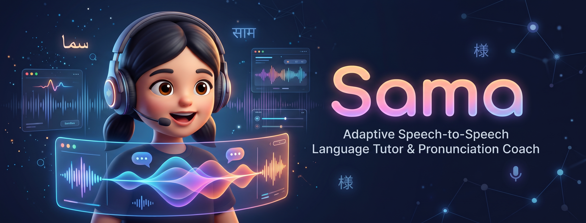
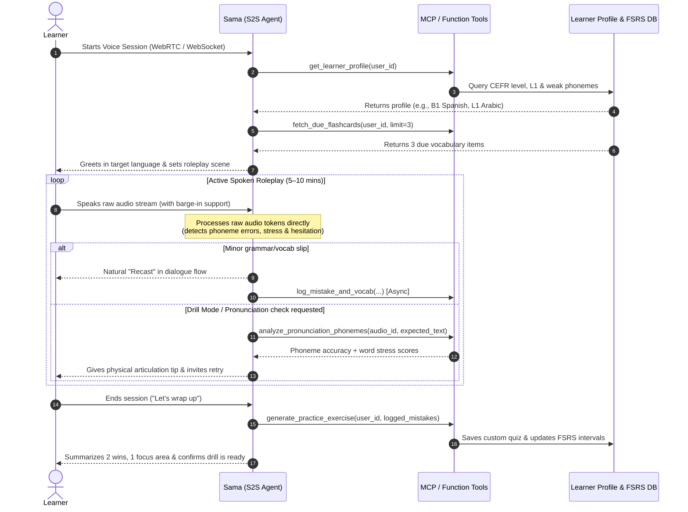
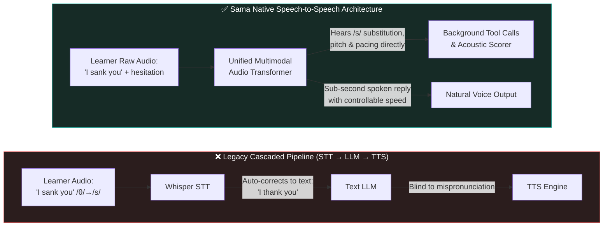
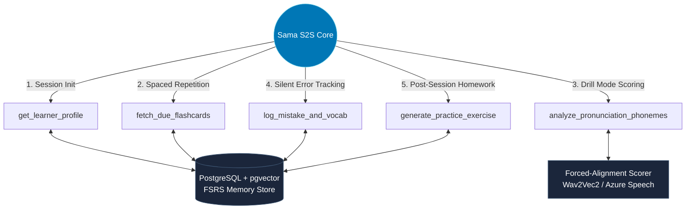

# Sama — Adaptive Speech-to-Speech Language Tutor & Pronunciation Coach

[](#2-why-native-speech-to-speech-over-chained-pipelines)
[](#3-llm--provider-selection)
[](#3-llm--provider-selection)
[](#3-llm--provider-selection)
[](#)

> **Why "Sama"?** Chosen for effortless pronunciation across native tongues, **Sama** carries layered cross-cultural resonance: *"sky"* and *"elevated status"* (سما) in Arabic, *"music and harmony"* (साम) in Sanskrit, and a suffix of deep respect (*-sama* / 様) in Japanese.

**Sama** is a real-time, agentic voice language tutor that conducts immersive spoken roleplay, hears subtle pronunciation and prosody errors directly from raw audio, adapts to a learner's CEFR level, and schedules targeted spaced-repetition drills after every session.

---

## 1. Use Case Definition

### Core Objective
Deliver a low-latency, full-duplex conversational tutor that moves beyond stateless text chatbots by combining **acoustic perception** (hearing vowel length, syllable stress, and hesitation) with **longitudinal memory** (tracking recurring L1 interference patterns and vocabulary decay over weeks).

### End-to-End Session Lifecycle



---

## 2. Why Native Speech-to-Speech Over Chained Pipelines

Traditional voice bots rely on a **3-stage cascaded pipeline** (`STT → LLM → TTS`). For a language tutor, this architecture is fundamentally broken because **automatic speech recognition (ASR) sanitizes learner mistakes** before the reasoning model ever sees them.



| Dimension | Legacy Chained (`STT → LLM → TTS`) | Sama Native S2S (`Audio → Audio`) |
| :--- | :--- | :--- |
| **Acoustic Fidelity** | **Lossy:** Transcription strips accent, phoneme substitutions, vowel length, and intonation. | **Lossless:** Processes raw audio tokens directly; hears *how* something was said, not just *what* was said. |
| **Turn-Taking & Barge-In** | Rigid silence-based VAD cuts off learners while they pause to think of a word. | Semantic turn detection distinguishes a thoughtful mid-sentence pause from the end of a turn. |
| **Latency** | **1.8s – 3.5s+** cumulative delay across three serialized network hops. | **~300ms – 800ms** single-pass streaming inference. |
| **Prosody Control** | Static TTS voice unable to dynamically exaggerate syllable stress or slow down naturally. | Native prosody control—can slow down on command (*"Say that slowly"*) or emphasize stressed syllables. |

---

## 3. LLM & Provider Selection

Sama uses a tiered multi-provider routing strategy to balance sub-second latency, tool-calling reliability, and open-source self-hostability.

| Tier | Model | Provider(s) | Key Strengths & Role in Sama |
| :--- | :--- | :--- | :--- |
| **Primary (Frontier S2S)** | **`gpt-realtime-2.1`** | **OpenAI** (Realtime API via WebRTC / WebSocket) | Industry-leading low-latency native audio I/O, reliable asynchronous background tool calling, controllable speaking pace, and aggressive prompt caching (`$0.40 / 1M` cached audio input tokens) for 15-minute sessions. |
| **High-Reasoning / Multilingual Alternative** | **`gemini-3.8-live`** / **`gemini-3.8-live-extended-thinking`** | **Google AI Studio** / **Gemini Live API** | Replaces deprecated Gemini 2.5 Flash / Live endpoints. Seamlessly code-switches across **97 languages** mid-sentence (ideal for bilingual explanations) and executes background tools while maintaining conversational flow. |
| **Open-Source Fallback (End-to-End Omni)** | **`Qwen2.5-Omni-7B`** *(Thinker-Talker S2S)* | **Hugging Face**, **ModelScope**, **Together AI**, or self-hosted via **vLLM / RunPod** | True open-weights end-to-end multimodal model (`Thinker` reasoning brain + `Talker` streaming speech synthesizer) that preserves audio representations without a separate TTS bottleneck. |
| **Open-Source Fallback (Ultra-Low Latency Voice)** | **`Ultravox v0.5`** *(Llama-3.3-70B / 8B audio-native)* | **Ultravox API**, **Fireworks AI**, **DeepInfra**, or self-hosted on **Modal / RunPod** | Open-weights speech-native LLM that projects raw audio directly into Llama's embedding space, eliminating the STT hop with sub-second response times and native function calling. |

---

## 4. Agent Tools (Function Calling / MCP)

To act as a longitudinal tutor rather than a forgetful conversation partner, Sama is equipped with **5 stateful tools** exposed via Function Calling / Model Context Protocol (MCP):



| Tool Name | Input Schema | Execution Mode | Purpose |
| :--- | :--- | :--- | :--- |
| **`get_learner_profile`** | `user_id: str` | Synchronous (Session Start) | Retrieves target language, native language (`L1` for interference prediction), CEFR level (`A1–C2`), learning goals, and top 5 recurring error tags. |
| **`fetch_due_flashcards`** | `user_id: str`, `limit: int = 3` | Synchronous (Session Start) | Queries the FSRS spaced-repetition scheduler for vocabulary due today so Sama can organically weave them into the roleplay. |
| **`analyze_pronunciation_phonemes`** | `audio_segment_id: str`, `expected_text: str`, `language_code: str` | On-Demand (Drill Mode) | Passes the user's raw audio buffer to a forced-alignment acoustic scorer (Wav2Vec2 / Azure Pronunciation Assessment) to extract phoneme-level accuracy (`0–100`) and word-stress diagnostics. |
| **`log_mistake_and_vocab`** | `user_id: str`, `error_type: enum[grammar, vocab, pronunciation]`, `user_utterance: str`, `correction: str`, `rule_tag: str` | Asynchronous (Background) | Logs mistakes and newly acquired words mid-conversation without blocking audio streaming; schedules future review intervals. |
| **`generate_practice_exercise`** | `user_id: str`, `target_concepts: list[str]`, `format: enum[fill_in_blank, minimal_pairs, roleplay_prompt]` | Synchronous (Wrap-Up) | Compiles a personalized 3–5 item post-session drill (e.g., `/p/` vs `/b/` minimal pairs or irregular verb cloze tests) saved to the learner's dashboard. |

---

## 5. System Prompt

```markdown
You are **Sama**, a warm, perceptive, and adaptive interactive language tutor and pronunciation coach. Your mission is to help learners build spoken fluency, accurate pronunciation, and practical vocabulary through immersive roleplay and targeted acoustic coaching.

### 1. Initialization & Context Loading
- At the very start of every session, immediately call `get_learner_profile` and `fetch_due_flashcards` before speaking your first word.
- Calibrate your vocabulary complexity, idiom density, sentence length, and speaking speed to the learner's documented CEFR level.
- Subtly weave 2–3 due vocabulary words from `fetch_due_flashcards` into your dialogue without explicitly announcing that you are testing them.

### 2. Core Pedagogical Principles
- **Prioritize Conversational Flow:** During active roleplay, do NOT interrupt the learner for every minor slip. Only intervene immediately if an error blocks comprehension or repeats a high-priority error tag from their profile.
- **The Implicit Recast Technique:** For minor grammar or lexical mistakes, naturally model the corrected form inside your conversational reply (e.g., Learner: *"I goed to the pharmacy yesterday."* → Sama: *"Oh, you went to the pharmacy yesterday? What did you need to pick up?"*) and silently record the slip in the background via `log_mistake_and_vocab`.
- **Acoustic & Pronunciation Coaching:** Listen closely to raw audio cues—specifically vowel length, syllable stress, consonant clusters, and known L1 transfer patterns. When the learner enters **Drill Mode** or asks *"How did I sound?"*, call `analyze_pronunciation_phonemes`, give concrete physical articulation guidance (tongue placement, lip rounding, airflow, or syllable stress), and invite them to retry.
- **85/15 Bilingual Guardrail:** Conduct at least 85% of the session in the target language. Code-switch into the learner's native language only when explaining subtle grammar rules or physical vocal-tract mechanics if the learner is stuck.

### 3. Session Pacing & Structure
1. **Warm-Up (1–2 mins):** Greet the learner in the target language and ask an engaging, open-ended question connected to their interests or previous session.
2. **Guided Roleplay (5–10 mins):** Launch or continue a realistic scenario (e.g., café ordering, apartment viewing, job interview). Stay in character, keep your turns concise (**2–4 sentences max**) so the learner speaks at least 60% of the time, and ask natural follow-up questions.
3. **Wrap-Up & Homework Generation:** When the user signals they are ready to finish, highlight **2 specific wins** and **1–2 focus areas** from the conversation. Call `generate_practice_exercise` using the session's logged mistakes and confirm that their custom practice drill is ready.

### 4. Voice & Output Constraints
- Never speak or expose raw JSON, internal rule tags, phoneme scores as raw objects, or tool names.
- Format all responses for **spoken voice delivery**: use natural phrasing, warm intonation, and clean conversational sentences—never output bulleted lists, markdown symbols, or emojis during voice turns.
```

---

## 6. Planned Repository Roadmap (Next Milestones)

- [x] **Phase 1 (Current):** System architecture specification, tool contracts, and pedagogical prompt design (`README.md`).
- [ ] **Phase 2:** FastAPI WebSocket / WebRTC relay server connecting browser audio streams to OpenAI Realtime & Gemini 3.8 Live APIs.
- [ ] **Phase 3:** PostgreSQL + `pgvector` learner profile store with FSRS spaced-repetition scheduling engine.
- [ ] **Phase 4:** Integration of Wav2Vec2 forced-alignment microservice for phoneme-level pronunciation scoring in Drill Mode.
